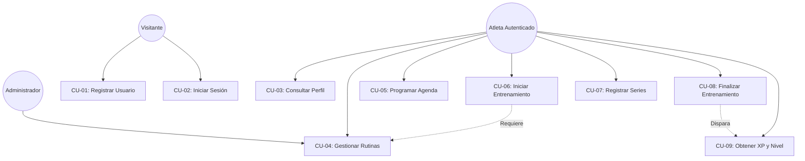
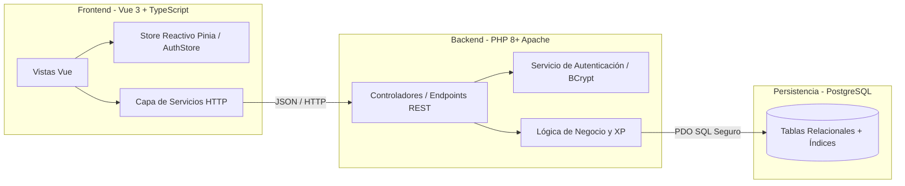
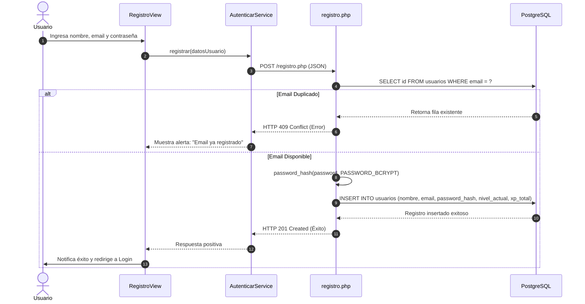
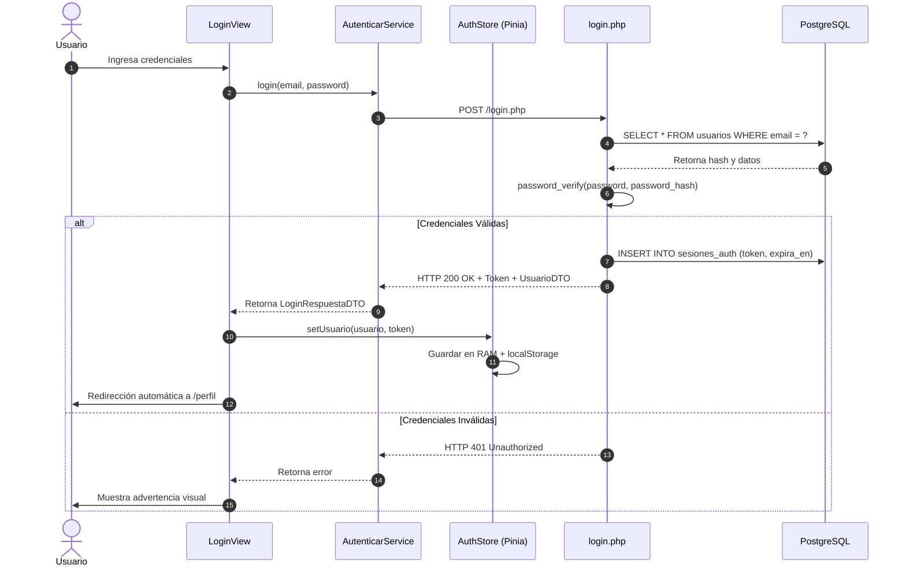
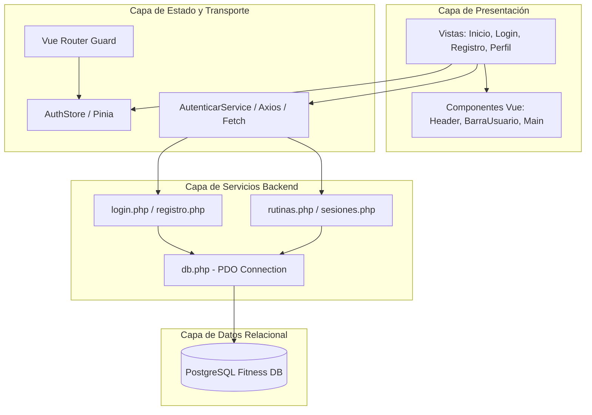
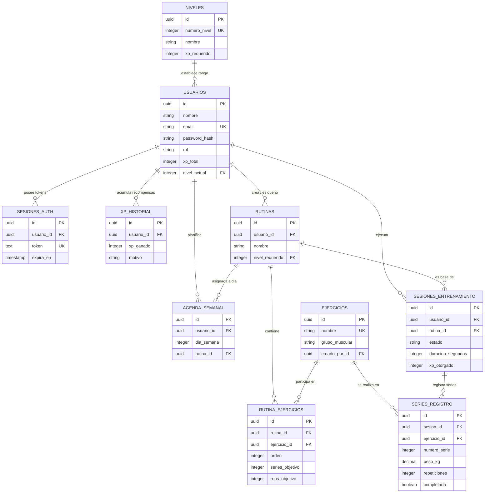

# FITCORE — Documentación Técnica de Ingeniería de Software

**Proyecto:** FITCORE  
**Versión del Sistema:** 1.0.0 (MVP 1 - MVP 4)  
**Tipo de Documento:** Especificación Técnica, SRS, Arquitectura y Manual de Implementación  
**Autor:** Equipo de Ingeniería FITCORE  
**Fecha de Publicación:** Octubre 2026  

---

## ÍNDICE GENERAL

1. [INTRODUCCIÓN](#1-introducción)  
   1.1 [Propósito del documento](#11-propósito-del-documento)  
   1.2 [Descripción general de FITCORE](#12-descripción-general-de-fitcore)  
2. [DESCRIPCIÓN GENERAL DEL SISTEMA](#2-descripción-general-del-sistema)  
   2.1 [Propósito del sistema](#21-propósito-del-sistema)  
   2.2 [Objetivos](#22-objetivos)  
   2.3 [Alcance del sistema](#23-alcance-del-sistema)  
   2.4 [Usuarios del sistema](#24-usuarios-del-sistema)  
   2.5 [Problema que resuelve](#25-problema-que-resuelve)  
   2.6 [Funcionalidades principales](#26-funcionalidades-principales)  
3. [ESPECIFICACIÓN DE REQUERIMIENTOS](#3-especificación-de-requerimientos)  
   3.1 [Introducción a los requerimientos](#31-introducción-a-los-requerimientos)  
   3.2 [Requerimientos funcionales](#32-requerimientos-funcionales)  
   3.3 [Requerimientos no funcionales](#33-requerimientos-no-funcionales)  
       3.3.1 [Seguridad](#331-seguridad)  
       3.3.2 [Rendimiento](#332-rendimiento)  
       3.3.3 [Mantenibilidad](#333-mantenibilidad)  
       3.3.4 [Usabilidad](#334-usabilidad)  
       3.3.5 [Compatibilidad](#335-compatibilidad)  
       3.3.6 [Persistencia](#336-persistencia)  
       3.3.7 [Comunicación](#337-comunicación)  
4. [ANÁLISIS DEL SISTEMA](#4-análisis-del-sistema)  
   4.1 [Identificación de actores](#41-identificación-de-actores)  
   4.2 [Actores del sistema](#42-actores-del-sistema)  
   4.3 [Casos de uso](#43-casos-de-uso)  
   4.4 [Diagrama general de casos de uso](#44-diagrama-general-de-casos-de-uso)  
   4.5 [Especificación de casos de uso](#45-especificación-de-casos-de-uso)  
       4.5.1 [CU-01 Registrar usuario](#451-cu-01-registrar-usuario)  
       4.5.2 [CU-02 Iniciar sesión](#452-cu-02-iniciar-sesión)  
       4.5.3 [CU-03 Consultar perfil](#453-cu-03-consultar-perfil)  
       4.5.4 [CU-04 Gestionar rutinas](#454-cu-04-gestionar-rutinas)  
       4.5.5 [CU-05 Programar rutina](#455-cu-05-programar-rutina)  
       4.5.6 [CU-06 Iniciar entrenamiento](#456-cu-06-iniciar-entrenamiento)  
       4.5.7 [CU-07 Registrar series](#457-cu-07-registrar-series)  
       4.5.8 [CU-08 Finalizar entrenamiento](#458-cu-08-finalizar-entrenamiento)  
       4.5.9 [CU-09 Obtener XP](#459-cu-09-obtener-xp)  
   4.6 [Flujos principales](#46-flujos-principales)  
   4.7 [Flujos alternativos](#47-flujos-alternativos)  
   4.8 [Precondiciones y postcondiciones](#48-precondiciones-y-postcondiciones)  
   4.9 [Modelo conceptual](#49-modelo-conceptual)  
   4.10 [Modelo de dominio](#410-modelo-de-dominio)  
5. [DISEÑO Y ARQUITECTURA](#5-diseño-y-arquitectura)  
   5.1 [Introducción](#51-introducción)  
   5.2 [Arquitectura general](#52-arquitectura-general)  
   5.3 [Arquitectura frontend](#53-arquitectura-frontend)  
   5.4 [Arquitectura backend](#54-arquitectura-backend)  
   5.5 [Arquitectura de base de datos](#55-arquitectura-de-base-de-datos)  
   5.6 [Comunicación entre capas](#56-comunicación-entre-capas)  
   5.7 [Patrón de separación de responsabilidades](#57-patrón-de-separación-de-responsabilidades)  
       5.7.1 [Modelo](#571-modelo)  
       5.7.2 [Vista](#572-vista)  
       5.7.3 [Controlador](#573-controlador)  
       5.7.4 [Servicios](#574-servicios)  
   5.8 [DTO y transferencia de datos](#58-dto-y-transferencia-de-datos)  
   5.9 [Flujo de autenticación](#59-flujo-de-autenticación)  
   5.10 [Flujo de registro](#510-flujo-de-registro)  
   5.11 [Flujo de inicio de sesión](#511-flujo-de-inicio-de-sesión)  
   5.12 [Flujo de entrenamiento](#512-flujo-de-entrenamiento)  
   5.13 [Diagrama de componentes](#513-diagrama-de-componentes)  
   5.14 [Diagrama de secuencia](#514-diagrama-de-secuencia)  
   5.15 [Estructura del proyecto](#515-estructura-del-proyecto)  
   5.16 [Decisiones de diseño](#516-decisiones-de-diseño)  
6. [DISEÑO DE BASE DE DATOS](#6-diseño-de-base-de-datos)  
   6.1 [Motor de base de datos](#61-motor-de-base-de-datos)  
   6.2 [Modelo conceptual](#62-modelo-conceptual)  
   6.3 [Modelo lógico](#63-modelo-lógico)  
   6.4 [Modelo físico](#64-modelo-físico)  
   6.5 [Entidades](#65-entidades)  
       6.5.1 [niveles](#651-niveles)  
       6.5.2 [usuarios](#652-usuarios)  
       6.5.3 [sesiones_auth](#653-sesiones_auth)  
       6.5.4 [xp_historial](#654-xp_historial)  
       6.5.5 [ejercicios](#655-ejercicios)  
       6.5.6 [rutinas](#656-rutinas)  
       6.5.7 [rutina_ejercicios](#657-rutina_ejercicios)  
       6.5.8 [agenda_semanal](#658-agenda_semanal)  
       6.5.9 [sesiones_entrenamiento](#659-sesiones_entrenamiento)  
       6.5.10 [series_registro](#6510-series_registro)  
   6.6 [Claves primarias](#66-claves-primarias)  
   6.7 [Claves foráneas](#67-claves-foráneas)  
   6.8 [Relaciones](#68-relaciones)  
   6.9 [Cardinalidades](#69-cardinalidades)  
   6.10 [Restricciones de integridad](#610-restricciones-de-integridad)  
   6.11 [Restricciones CHECK](#611-restricciones-check)  
   6.12 [Restricciones UNIQUE](#612-restricciones-unique)  
   6.13 [Integridad referencial](#613-integridad-referencial)  
   6.14 [Índices](#614-índices)  
   6.15 [Decisiones de diseño de la base de datos](#615-decisiones-de-diseño-de-la-base-de-datos)  
   6.16 [Diagrama Entidad-Relación](#616-diagrama-entidad-relación)  
   6.17 [Esquema final](#617-esquema-final)  
7. [DISEÑO DE INTERFAZ](#7-diseño-de-interfaz)  
   7.1 [Principios generales](#71-principios-generales)  
   7.2 [Estructura de navegación](#72-estructura-de-navegación)  
   7.3 [Vista de inicio](#73-vista-de-inicio)  
   7.4 [Vista de registro](#74-vista-de-registro)  
   7.5 [Vista de inicio de sesión](#75-vista-de-inicio-de-sesión)  
   7.6 [Vista de perfil](#76-vista-de-perfil)  
   7.7 [Vista de rutinas](#77-vista-de-rutinas)  
   7.8 [Vista de entrenamiento](#78-vista-de-entrenamiento)  
   7.9 [Mensajes y validaciones](#79-mensajes-y-validaciones)  
   7.10 [Prototipos](#710-prototipos)  
   7.11 [Capturas de la implementación final](#711-capturas-de-la-implementación-final)  
8. [API Y SERVICIOS](#8-api-y-servicios)  
   8.1 [Introducción](#81-introducción)  
   8.2 [Comunicación HTTP](#82-comunicación-http)  
   8.3 [Formato JSON](#83-formato-json)  
   8.4 [Endpoints](#84-endpoints)  
   8.5 [Autenticación](#85-autenticación)  
   8.6 [Registro](#86-registro)  
   8.7 [Login](#87-login)  
   8.8 [Logout](#88-logout)  
   8.9 [Perfil](#89-perfil)  
   8.10 [Rutinas](#810-rutinas)  
   8.11 [Sesiones](#811-sesiones)  
   8.12 [Series](#812-series)  
   8.13 [XP](#813-xp)  
   8.14 [Códigos HTTP](#814-códigos-http)  
   8.15 [Manejo de errores](#815-manejo-de-errores)  
   8.16 [DTO utilizados](#816-dto-utilizados)  
   8.17 [Flujo frontend → API → base de datos](#817-flujo-frontend--api--base-de-datos)  
9. [PROCESO DE DESARROLLO](#9-proceso-de-desarrollo)  
   9.1 [Preparación inicial](#91-preparación-inicial)  
   9.2 [Configuración del entorno](#92-configuración-del-entorno)  
   9.3 [Creación del frontend](#93-creación-del-frontend)  
   9.4 [Creación de componentes](#94-creación-de-componentes)  
   9.5 [Creación de vistas](#95-creación-de-vistas)  
   9.6 [Creación de servicios](#96-creación-de-servicios)  
   9.7 [Definición de DTO](#97-definición-de-dto)  
   9.8 [Desarrollo del backend](#98-desarrollo-del-backend)  
   9.9 [Configuración de PostgreSQL](#99-configuración-de-postgresql)  
   9.10 [Implementación del registro](#910-implementación-del-registro)  
   9.11 [Implementación del login](#911-implementación-del-login)  
   9.12 [Implementación de autenticación](#912-implementación-de-autenticación)  
   9.13 [Implementación de rutinas](#913-implementación-de-rutinas)  
   9.14 [Implementación de sesiones](#914-implementación-de-sesiones)  
   9.15 [Implementación del sistema de XP](#915-implementación-del-sistema-de-xp)  
   9.16 [Integración frontend-backend](#916-integración-frontend-backend)  
   9.17 [Corrección de errores](#917-corrección-de-errores)  
   9.18 [Estado alcanzado](#918-estado-alcanzado)  
   9.19 [Problemas encontrados y soluciones](#919-problemas-encontrados-y-soluciones)  
10. [IMPLEMENTACIÓN](#10-implementación)  
    10.1 [Estructura de archivos](#101-estructura-de-archivos)  
    10.2 [Frontend](#102-frontend)  
    10.3 [Backend](#103-backend)  
    10.4 [Servicios](#104-servicios)  
    10.5 [Componentes](#105-componentes)  
    10.6 [Vistas](#106-vistas)  
    10.7 [Endpoints PHP](#107-endpoints-php)  
    10.8 [Acceso a PostgreSQL](#108-acceso-a-postgresql)  
    10.9 [Validaciones](#109-validaciones)  
    10.10 [Autenticación](#1010-autenticación)  
    10.11 [Manejo de errores](#1011-manejo-de-errores)  
    10.12 [Integración de componentes](#1012-integración-de-componentes)  
11. [PLAN DE PRUEBAS](#11-plan-de-pruebas)  
    11.1 [Objetivos de las pruebas](#111-objetivos-de-las-pruebas)  
    11.2 [Estrategia de pruebas](#112-estrategia-de-pruebas)  
    11.3 [Alcance](#113-alcance)  
    11.4 [Tipos de pruebas](#114-tipos-de-pruebas)  
        11.4.1 [Pruebas funcionales](#1141-pruebas-funcionales)  
        11.4.2 [Pruebas de integración](#1142-pruebas-de-integración)  
        11.4.3 [Pruebas de API](#1143-pruebas-de-api)  
        11.4.4 [Pruebas de base de datos](#1144-pruebas-de-base-de-datos)  
        11.4.5 [Pruebas de interfaz](#1145-pruebas-de-interfaz)  
        11.4.6 [Pruebas de validación](#1146-pruebas-de-validación)  
    11.5 [Casos de prueba](#115-casos-de-prueba)  
    11.6 [Datos de prueba](#116-datos-de-prueba)  
    11.7 [Resultados](#117-resultados)  
    11.8 [Evidencias](#118-evidencias)  
    11.9 [Errores encontrados](#119-errores-encontrados)  
    11.10 [Correcciones realizadas](#1110-correcciones-realizadas)  
    11.11 [Resultado final](#1111-resultado-final)  
12. [INSTALACIÓN Y CONFIGURACIÓN](#12-instalación-y-configuración)  
    12.1 [Requisitos del sistema](#121-requisitos-del-sistema)  
    12.2 [Herramientas necesarias](#122-herramientas-necesarias)  
    12.3 [Instalación del frontend](#123-instalación-del-frontend)  
    12.4 [Instalación de PHP](#124-instalación-de-php)  
    12.5 [Instalación de PostgreSQL](#125-instalación-de-postgresql)  
    12.6 [Creación de la base de datos](#126-creación-de-la-base-de-datos)  
    12.7 [Ejecución del script SQL](#127-ejecución-del-script-sql)  
    12.8 [Configuración de conexión](#128-configuración-de-conexión)  
    12.9 [Configuración de Apache](#129-configuración-de-apache)  
    12.10 [Configuración de CORS](#1210-configuración-de-cors)  
    12.11 [Ejecución del proyecto](#1211-ejecución-del-proyecto)  
    12.12 [Verificación de instalación](#1212-verificación-de-instalación)  
    12.13 [Problemas frecuentes](#1213-problemas-frecuentes)  

---

## 1. INTRODUCCIÓN

### 1.1 Propósito del documento
El propósito fundamental de este documento es formalizar de manera exhaustiva y rigurosa la ingeniería, arquitectura, diseño de base de datos, lógica de negocio y especificación de requerimientos de **FITCORE**. Este manual está concebido como el punto de referencia definitivo para desarrolladores, arquitectos de software y auditores técnicos que interactúen con el ecosistema de la aplicación, garantizando que cada decisión de diseño, estructura de datos y flujo de información se comprenda y mantenga sin ambigüedades.

### 1.2 Descripción general de FITCORE
**FITCORE** es una plataforma integral y gamificada orientada al entrenamiento físico, calistenia y acondicionamiento progresivo. La aplicación combina una interfaz moderna en **Vue 3 + TypeScript (Vite)**, una capa de servicios desacoplada con **Data Transfer Objects (DTOs)**, un backend robusto basado en **PHP 8+** con arquitectura orientada a servicios y un motor relacional de alta fidelidad sobre **PostgreSQL**. FITCORE no solo registra series y repeticiones, sino que gamifica la adherencia al ejercicio mediante un motor de experiencia (XP), niveles escalonados, bloqueo matemático de rutinas por nivel y agendas semanales personalizadas.

---

## 2. DESCRIPCIÓN GENERAL DEL SISTEMA

### 2.1 Propósito del sistema
Proveer a atletas, entusiastas del fitness y principiantes una herramienta web progresiva que elimine la fricción del entrenamiento desestructurado, ofreciendo una guía interactiva en tiempo real, trazabilidad completa de cada repetición y un incentivo psicológico cuantificable a través de recompensas por gamificación.

### 2.2 Objetivos
- **Automatizar el ciclo de vida del entrenamiento:** desde la planificación semanal hasta la ejecución física serie por serie.
- **Garantizar la consistencia de datos:** centralizar el estado de sesión y de entrenamiento en memoria reactiva con soporte para recarga (F5) mediante persistencia local segura.
- **Implementar progresión matemática:** desbloquear rutinas y contenidos según el nivel alcanzado por el usuario mediante fórmulas de XP acumulado.
- **Asegurar la integridad transaccional:** registrar cada evento deportivo como una transacción auditable e inmutable en base de datos.

### 2.3 Alcance del sistema
El sistema abarca 4 Fases/MVPs principales:
1. **MVP 1 (Identidad y Sesión):** Registro seguro, autenticación basada en tokens, control perimetral mediante Route Guards y perfil reactivo dinámico.
2. **MVP 2 (Catálogo y Restricciones):** Gestión de ejercicios globales vs. personalizados, catálogo jerárquico de rutinas y candados condicionales por nivel.
3. **MVP 3 (Agenda y Live Training):** Planificación semanal del calendario, cronómetro en vivo persistente, registro de series reales y control de estados de sesión.
4. **MVP 4 (Gamificación y Auditoría):** Asignación de XP transaccional, libro contable de recompensas (`xp_historial`) y motor de subida de nivel con desbloqueo dinámico.

### 2.4 Usuarios del sistema
- **Usuario Atleta / Alumno:** Crea su cuenta, consulta su perfil, planifica su semana, ejecuta entrenamientos en vivo, registra repeticiones y gana XP.
- **Administrador / Entrenador:** Gestiona el catálogo de ejercicios oficiales del sistema, establece umbrales de nivel y supervisa la integridad de la plataforma.

### 2.5 Problema que resuelve
Resuelve la alta tasa de abandono en el entrenamiento físico originada por la falta de estructura, la pérdida de motivación y el uso de anotadores analógicos obsoletos. A nivel técnico, erradica los fallos comunes en aplicaciones web novatas: variables de sesión volátiles atrapadas en vistas individuales, desincronización ante el refresco de página y arquitecturas sin separación de capas.

### 2.6 Funcionalidades principales
- Autenticación criptográfica con BCrypt y sesiones gestionadas por tokens.
- Perfil sincronizado en tiempo real con datos de base de datos (`xp_total`, `nivel_actual`, racha).
- Catálogo de rutinas con candados visuales inteligentes basados en inecuaciones de nivel.
- Planificador semanal interactivo asociado a los días del calendario (1 al 7).
- Modo "Entrenamiento en Vivo" con persistencia del cronómetro ante navegación involuntaria.
- Auditoría inmutable de XP ganado por sesión completada, ejercicios nuevos y rachas continuas.

---

## 3. ESPECIFICACIÓN DE REQUERIMIENTOS

### 3.1 Introducción a los requerimientos
Los requerimientos aquí expuestos definen formalmente las capacidades operativas, restricciones técnicas y estándares de calidad bajo la norma IEEE 830 para software de grado productivo.

### 3.2 Requerimientos funcionales
- **RF-01:** El sistema debe permitir el registro de nuevos usuarios capturando nombre, email y contraseña.
- **RF-02:** El sistema debe verificar la unicidad del email antes de registrar la cuenta.
- **RF-03:** El sistema debe cifrar irreversiblemente las contraseñas antes de almacenarlas en la base de datos.
- **RF-04:** El sistema debe autenticar credenciales y retornar un token de sesión junto con el perfil inicial.
- **RF-05:** El frontend debe almacenar el estado de sesión en un Store centralizado y sincronizarlo con `localStorage`.
- **RF-06:** El enrutador debe interceptar accesos no autorizados a rutas protegidas mediante Navigation Guards.
- **RF-07:** El sistema debe permitir al usuario consultar su perfil con su nivel, XP actual y progreso relativo.
- **RF-08:** El catálogo debe listar las rutinas y calcular dinámicamente el estado del candado según `usuario.nivel_actual >= rutina.nivel_requerido`.
- **RF-09:** El usuario debe poder asociar una rutina a un día de la semana (1 a 7) en su agenda.
- **RF-10:** El sistema debe permitir iniciar una sesión de entrenamiento cambiando el estado a `'en_progreso'`.
- **RF-11:** Durante el entrenamiento, el sistema debe registrar series con peso (kg) y repeticiones.
- **RF-12:** Al pulsar "Finalizar", el sistema debe calcular la duración total, cambiar el estado a `'completada'` e insertar un registro en `xp_historial`.
- **RF-13:** El motor de niveles debe recalcular si el usuario superó el umbral para subir de nivel e incrementar `nivel_actual`.
- **RF-14:** El sistema debe permitir cerrar la sesión eliminando el token de memoria y del almacenamiento local.

### 3.3 Requerimientos no funcionales

#### 3.3.1 Seguridad
- Hashing de contraseñas mediante algoritmo BCrypt con coste computacional estándar.
- Prevención total contra Inyección SQL mediante sentencias preparadas con PDO (`PDO::prepare`).
- Sanitización y validación estricta de esquemas de datos entrantes mediante DTOs tipados.
- Protección de endpoints privados mediante tokens de sesión y cabeceras `Authorization: Bearer`.

#### 3.3.2 Rendimiento
- Respuestas del backend en menos de 200 ms para consultas de perfil y catálogo.
- Bundle de frontend optimizado con Vite, carga diferida (lazy-loading) de rutas y división de código.
- Índices B-Tree optimizados en columnas de alta cardinalidad y búsqueda frecuente (`email`, `token`, `usuario_id`).

#### 3.3.3 Mantenibilidad
- Arquitectura desacoplada en tres niveles: Presentación (Vue 3), Transporte/Lógica (TypeScript/PHP) y Datos (PostgreSQL).
- Tipado estricto extremo con TypeScript sin uso de `any` permisivo.
- Modularización en paquetes compartidos (`@fitcore/shared`).

#### 3.3.4 Usabilidad
- Diseño responsivo adaptado para dispositivos móviles, tablets y monitores de escritorio.
- Tipografía moderna (Rubik), paleta de colores de alto contraste con estética oscura (dark mode) y micro-interacciones.
- Retroalimentación visual inmediata ante errores de red, campos inválidos y estados de carga.

#### 3.3.5 Compatibilidad
- Compatibilidad garantizada con navegadores modernos compatibles con ES2022+ (Chrome, Firefox, Safari, Edge).
- Compatibilidad del backend en entornos Linux/Windows con PHP 8.1+ y Apache 2.4+.

#### 3.3.6 Persistencia
- Motor PostgreSQL 15+ con integridad referencial estricta, claves foráneas en cascada controlada y transacciones ACID.
- Persistencia local del cliente tolerante a fallos mediante `localStorage` con serialización JSON validada.

#### 3.3.7 Comunicación
- Protocolo de transporte HTTP/1.1 y HTTPS.
- Carga útil (payload) estrictamente en formato `application/json`.
- Política CORS configurada con cabeceras `Access-Control-Allow-Origin`, `Access-Control-Allow-Headers` y `Access-Control-Allow-Methods`.

---

## 4. ANÁLISIS DEL SISTEMA

### 4.1 Identificación de actores
El análisis del sistema identifica a los agentes que interactúan con las fronteras del software, clasificándolos según sus roles y privilegios.

### 4.2 Actores del sistema
- **Visitante Anónimo:** Usuario no registrado que solo tiene acceso a la Landing Page, Formulario de Registro y Formulario de Login.
- **Usuario Autenticado (Atleta):** Usuario con cuenta activa y token válido con acceso a su perfil, rutinas, agenda, entrenamiento y recompensas.
- **Administrador:** Usuario con rol `'admin'` facultado para sembrar rutinas oficiales y supervisar ejercicios globales.

### 4.3 Casos de uso
La operatividad nuclear del sistema se divide en 9 casos de uso fundamentales que abarcan el ciclo de vida completo de la aplicación.

### 4.4 Diagrama general de casos de uso



### 4.5 Especificación de casos de uso

#### 4.5.1 CU-01 Registrar usuario
- **Actor:** Visitante.
- **Descripción:** Permite a una persona crear una cuenta en el sistema.
- **Disparador:** El usuario pulsa "Crear Cuenta".

#### 4.5.2 CU-02 Iniciar sesión
- **Actor:** Visitante.
- **Descripción:** Valida credenciales, emite un token de sesión e inicializa el perfil en el cliente.
- **Disparador:** El usuario envía el formulario de login.

#### 4.5.3 CU-03 Consultar perfil
- **Actor:** Atleta.
- **Descripción:** Muestra nombre, nivel, barra de progreso de XP y racha del atleta en tiempo real.
- **Disparador:** Navegación a `/perfil` o carga inicial de la aplicación.

#### 4.5.4 CU-04 Gestionar rutinas
- **Actor:** Atleta / Admin.
- **Descripción:** Lista rutinas públicas y privadas, evaluando si el candado visual se encuentra abierto o bloqueado.
- **Disparador:** El usuario accede a la vista de rutinas.

#### 4.5.5 CU-05 Programar rutina
- **Actor:** Atleta.
- **Descripción:** Asigna una rutina específica a uno de los días de la semana (1 a 7).
- **Disparador:** El atleta selecciona un día en el calendario interactivo.

#### 4.5.6 CU-06 Iniciar entrenamiento
- **Actor:** Atleta.
- **Descripción:** Registra una sesión con estado `'en_progreso'` y activa el cronómetro en el cliente.
- **Disparador:** El atleta pulsa "Comenzar Entrenamiento".

#### 4.5.7 CU-07 Registrar series
- **Actor:** Atleta.
- **Descripción:** Guarda peso y repeticiones ejecutadas para cada serie de un ejercicio.
- **Disparador:** El atleta marca como completada una serie.

#### 4.5.8 CU-08 Finalizar entrenamiento
- **Actor:** Atleta.
- **Descripción:** Calcula el tiempo total transcurrido, cambia el estado a `'completada'` y cierra la sesión de entrenamiento.
- **Disparador:** El atleta presiona "Terminar Entrenamiento".

#### 4.5.9 CU-09 Obtener XP
- **Actor:** Sistema / Atleta.
- **Descripción:** Genera el asiento contable en `xp_historial`, acumula `xp_total` y actualiza `nivel_actual` si corresponde.
- **Disparador:** Evento posterior al éxito de CU-08.

### 4.6 Flujos principales
1. **Flujo de Inicio:** Formulario Login → Servicio HTTP POST → PHP valida BCrypt → Retorna DTO Usuario + Token → Store guarda en RAM y LocalStorage → Router redirige a `/perfil`.
2. **Flujo de Entrenamiento:** Selección de rutina → Inserción de sesión `'en_progreso'` → Registro serie a serie → Finalización → Disparo de XP → Ascenso de nivel → Desbloqueo en catálogo.

### 4.7 Flujos alternativos
- **Email ya registrado (CU-01):** El backend detecta duplicado en `usuarios.email`, rechaza la inserción y retorna HTTP 409 con mensaje de error descriptivo.
- **Credenciales inválidas (CU-02):** Contraseña errónea o email inexistente; retorna HTTP 401 sin exponer si el fallo fue el usuario o la clave.
- **Rutina bloqueada (CU-04/CU-06):** Si `nivel_actual < nivel_requerido`, el botón de inicio se deshabilita y se renderiza un candado con el nivel requerido.

### 4.8 Precondiciones y postcondiciones
- **CU-02:** Precondición: Estar registrado. Postcondición: Estado de autenticación activo globalmente.
- **CU-08:** Precondición: Tener sesión `'en_progreso'`. Postcondición: Sesión `'completada'`, XP abonado, auditoría creada.

### 4.9 Modelo conceptual
El modelo conceptual concibe al **Usuario** como la entidad raíz. Un usuario posee un **Nivel**, acumula registros de **Historial XP**, mantiene una **Agenda Semanal**, define o utiliza **Rutinas** compuestas por **Ejercicios**, y materializa su actividad en **Sesiones de Entrenamiento** formadas por múltiples **Series**.

### 4.10 Modelo de dominio
El dominio de FITCORE modela la relación inseparable entre el esfuerzo físico medido y la progresión matemática, garantizando que ninguna recompensa se otorgue sin un evento deportivo verificado.

---

## 5. DISEÑO Y ARQUITECTURA

### 5.1 Introducción
FITCORE implementa una arquitectura moderna de Aplicación de Página Única (SPA) desacoplada de su API de servicios, siguiendo el principio de inversión de dependencias y responsabilidad única.

### 5.2 Arquitectura general



### 5.3 Arquitectura frontend
El frontend está construido sobre **Vue 3 Composition API (`<script setup lang="ts">`)**:
- **Router perimetral (`vue-router`):** Controla transiciones y valida guardias de seguridad mediante `router.beforeEach`.
- **Capa de Transporte:** Clases de servicio (`AutenticarService`, `PasoService`) que aíslan las llamadas `fetch()`.
- **Memoria Reactiva Central:** Almacena el estado de identidad en un Store global independiente de las vistas que se destruyen.

### 5.4 Arquitectura backend
El backend expone una interfaz REST estructurada en endpoints PHP modulares ejecutados sobre Apache:
- Manejo estructurado de excepciones con bloques `try...catch`.
- Conexión persistente PDO configurada con `PDO::ATTR_ERRMODE => PDO::ERRMODE_EXCEPTION`.
- Despacho garantizado de cabeceras JSON con códigos de respuesta HTTP semánticos.

### 5.5 Arquitectura de base de datos
Base de datos relacional construida en **PostgreSQL**, utilizando claves primarias UUID universales (`uuid-ossp`), triggers automáticos para control temporal de actualización (`fn_updated_at`), comprobaciones CHECK y claves foráneas en cascada controlada.

### 5.6 Comunicación entre capas
La comunicación cliente-servidor es 100% asíncrona mediante JSON sobre HTTPS/HTTP, utilizando el verbo HTTP correspondiente (`GET`, `POST`, `PUT`, `DELETE`). El cliente serializa los DTOs y el backend los desempaqueta validando tipos antes de interactuar con la base de datos.

### 5.7 Patrón de separación de responsabilidades

#### 5.7.1 Modelo
Representado por las interfaces y esquemas TypeScript en el frontend (`Auth.DTO.ts`) y las entidades de base de datos en PostgreSQL.

#### 5.7.2 Vista
Componentes `.vue` puros (`LoginView.vue`, `PerfilView.vue`, `Header.vue`) dedicados exclusivamente a la presentación visual y reactividad del DOM.

#### 5.7.3 Controlador
Los scripts de entrada PHP (`login.php`, `registro.php`) que reciben la petición, orquestan las validaciones y formatean la respuesta.

#### 5.7.4 Servicios
Módulos TypeScript (`autenticar.service.ts`) que ejecutan las llamadas HTTP, encapsulan cabeceras y controlan fallos de red.

### 5.8 DTO y transferencia de datos
Los DTOs definen contratos inmutables de comunicación. Ningún dato entra o sale del sistema sin respetar su interfaz estricta:
- `UsuarioDTO`: `{ id: string; nombre: string; email: string; rol: string; xp_total: number; nivel_actual: number; }`
- `LoginRespuestaDTO`: `{ exito: boolean; mensaje: string; token?: string; usuario?: UsuarioDTO; }`

### 5.9 Flujo de autenticación
El flujo de autenticación valida las credenciales contra el hash BCrypt, genera un token criptográfico único con expiración en `sesiones_auth` y retorna el paquete completo al cliente.

### 5.10 Flujo de registro



### 5.11 Flujo de inicio de sesión



### 5.12 Flujo de entrenamiento
Al iniciar un entrenamiento, se genera el registro en `sesiones_entrenamiento`. Cada serie completada se almacena en `series_registro`. Al presionar finalizar, se calculan las métricas, se actualiza el estado y se invoca la auditoría en `xp_historial`.

### 5.13 Diagrama de componentes



### 5.14 Diagrama de secuencia
*(Detallado en las secciones 5.10 y 5.11 para flujos de alta criticidad).*

### 5.15 Estructura del proyecto
```
ObsidiantFit/ (FITCORE)
├── Frontend/                      ← Código fuente del cliente Vue 3 + Vite
│   ├── src/
│   │   ├── assets/               ← Estilos globales y recursos estáticos
│   │   ├── components/           ← Header, BarraUsuario, Formularios, Rutinas
│   │   ├── composables/          ← Lógica compartida reactiva
│   │   ├── DTO/                  ← Contratos e interfaces TypeScript
│   │   ├── router/               ← Configuración de rutas y Navigation Guards
│   │   ├── services/             ← Servicios de transporte HTTP (fetch)
│   │   ├── stores/               ← Memoria global reactiva (AuthStore)
│   │   ├── views/                ← InicioView, LoginView, RegistroView, PerfilView
│   │   ├── App.vue               ← Contenedor principal de la aplicación
│   │   └── main.ts               ← Punto de entrada e inicialización de Vue
│   ├── index.html                ← Plantilla HTML del cliente
│   ├── package.json              ← Dependencias del frontend
│   └── vite.config.ts            ← Configuración del compilador Vite
├── packages/
│   └── shared/                   ← Paquete npm compartido (@fitcore/shared)
│       ├── src/                  ← Tipos comunes, roles y reglas de suscripción
│       └── package.json
├── database/
│   ├── migrations/               ← Scripts de migración y control de esquema
│   └── seeds/                    ← Datos iniciales de niveles y ejercicios
├── Backend/                      ← Endpoints PHP para Apache
│   ├── db.php                    ← Conexión PDO a PostgreSQL
│   ├── login.php                 ← Endpoint de inicio de sesión
│   └── registro.php              ← Endpoint de creación de cuentas
├── archivos md/                  ← Planes maestros, esquemas SQL y documentación
├── package.json                  ← Configuración raíz del Monorepo con Workspaces
└── setup-monorepo.ps1            ← Script de aprovisionamiento automatizado
```

### 5.16 Decisiones de diseño
1. **Adopción de Vue 3 Composition API:** Provee mayor cohesión lógica que Options API y un tipado superior con TypeScript.
2. **Uso de UUID v4 en base de datos:** Evita la enumeración maliciosa de IDs enteros y prepara la base para arquitecturas distribuidas.
3. **Persistencia dual (RAM + LocalStorage):** Resuelve la "sesión atrapada" en vistas locales y sobrevive al refresco de página (F5).
4. **Validación estricta en dos etapas:** Validación visual inmediata en el formulario del cliente y validación pericial de seguridad en el backend.

---

## 6. DISEÑO DE BASE DE DATOS

### 6.1 Motor de base de datos
**PostgreSQL 15+**, seleccionado por su robustez ante cargas transaccionales concurrentes, soporte nativo de UUID, restricciones CHECK avanzadas y fiabilidad ACID absoluta.

### 6.2 Modelo conceptual
El modelo conceptual organiza el universo de FITCORE en cuatro subsistemas interconectados:
1. **Subsistema de Identidad:** `usuarios`, `sesiones_auth`.
2. **Subsistema de Gamificación:** `niveles`, `xp_historial`.
3. **Subsistema de Planificación:** `ejercicios`, `rutinas`, `rutina_ejercicios`, `agenda_semanal`.
4. **Subsistema Operativo:** `sesiones_entrenamiento`, `series_registro`.

### 6.3 Modelo lógico
Se aplican las reglas de normalización hasta la **Tercera Forma Normal (3FN)**, eliminando redundancias y dependencias transitivas.

### 6.4 Modelo físico
Implementado en el script DDL `fitcore_schema.sql` con extensiones de optimización, índices B-Tree dedicados y tipos de datos de alta precisión.

### 6.5 Entidades

#### 6.5.1 niveles
Define la escala de rangos y umbrales mínimos de experiencia.
- `id` (UUID, PK)
- `numero_nivel` (INTEGER, UNIQUE, NOT NULL)
- `nombre` (VARCHAR(100), NOT NULL)
- `xp_requerido` (INTEGER, NOT NULL)
- `created_at` (TIMESTAMP, NOT NULL)

#### 6.5.2 usuarios
Almacena el perfil central, credenciales seguras y progreso actual.
- `id` (UUID, PK)
- `nombre` (VARCHAR(80), NOT NULL)
- `email` (VARCHAR(255), UNIQUE, NOT NULL)
- `password_hash` (VARCHAR(255), NOT NULL)
- `rol` (VARCHAR(20), NOT NULL, CHECK: 'usuario', 'admin')
- `xp_total` (INTEGER, NOT NULL, DEFAULT 0)
- `nivel_actual` (INTEGER, FK -> niveles.numero_nivel)
- `ultima_sesion_at` (TIMESTAMP)
- `created_at`, `updated_at` (TIMESTAMP)

#### 6.5.3 sesiones_auth
Almacena tokens de autenticación para persistencia y validación de peticiones.
- `id` (UUID, PK)
- `usuario_id` (UUID, FK -> usuarios.id ON DELETE CASCADE)
- `token` (TEXT, UNIQUE, NOT NULL)
- `expira_en` (TIMESTAMP, NOT NULL)
- `created_at` (TIMESTAMP, NOT NULL)

#### 6.5.4 xp_historial
Libro contable inmutable para registrar auditorías de puntos ganados.
- `id` (UUID, PK)
- `usuario_id` (UUID, FK -> usuarios.id ON DELETE CASCADE)
- `xp_ganado` (INTEGER, NOT NULL, CHECK > 0)
- `motivo` (VARCHAR(50), NOT NULL, CHECK: 'sesion_completada', 'ejercicio_nuevo', 'racha_diaria')
- `created_at` (TIMESTAMP, NOT NULL)

#### 6.5.5 ejercicios
Catálogo de movimientos de calistenia y gimnasio.
- `id` (UUID, PK)
- `nombre` (VARCHAR(200), UNIQUE, NOT NULL)
- `descripcion` (TEXT)
- `grupo_muscular` (VARCHAR(50), NOT NULL)
- `creado_por_id` (UUID, FK -> usuarios.id ON DELETE SET NULL)
- `created_at` (TIMESTAMP, NOT NULL)

#### 6.5.6 rutinas
Planes de entrenamiento estructurados con restricción de nivel.
- `id` (UUID, PK)
- `usuario_id` (UUID, FK -> usuarios.id ON DELETE CASCADE)
- `nombre` (VARCHAR(200), NOT NULL)
- `descripcion` (TEXT)
- `nivel_requerido` (INTEGER, FK -> niveles.numero_nivel)
- `created_at`, `updated_at` (TIMESTAMP)

#### 6.5.7 rutina_ejercicios
Tabla intermedia que establece la secuencia y metas de cada rutina.
- `id` (UUID, PK)
- `rutina_id` (UUID, FK -> rutinas.id ON DELETE CASCADE)
- `ejercicio_id` (UUID, FK -> ejercicios.id ON DELETE RESTRICT)
- `orden` (INTEGER, NOT NULL)
- `series_objetivo` (INTEGER, NOT NULL)
- `reps_objetivo` (INTEGER)
- `descanso_segundos` (INTEGER, DEFAULT 60)

#### 6.5.8 agenda_semanal
Asignación de rutinas a los días de la semana del atleta.
- `id` (UUID, PK)
- `usuario_id` (UUID, FK -> usuarios.id ON DELETE CASCADE)
- `dia_semana` (INTEGER, NOT NULL, CHECK BETWEEN 1 AND 7)
- `rutina_id` (UUID, FK -> rutinas.id ON DELETE SET NULL)

#### 6.5.9 sesiones_entrenamiento
Registro formal del nacimiento y conclusión de un entrenamiento físico.
- `id` (UUID, PK)
- `usuario_id` (UUID, FK -> usuarios.id ON DELETE CASCADE)
- `rutina_id` (UUID, FK -> rutinas.id ON DELETE SET NULL)
- `fecha` (TIMESTAMP, NOT NULL)
- `duracion_segundos` (INTEGER, CHECK >= 0)
- `estado` (VARCHAR(20), NOT NULL, CHECK: 'en_progreso', 'completada', 'cancelada')
- `xp_otorgado` (INTEGER, NOT NULL, CHECK >= 0)
- `notas` (TEXT)
- `created_at` (TIMESTAMP, NOT NULL)

#### 6.5.10 series_registro
Bitácora de repeticiones y kilajes ejecutados serie por serie.
- `id` (UUID, PK)
- `sesion_id` (UUID, FK -> sesiones_entrenamiento.id ON DELETE CASCADE)
- `ejercicio_id` (UUID, FK -> ejercicios.id ON DELETE RESTRICT)
- `numero_serie` (INTEGER, NOT NULL, CHECK > 0)
- `peso_kg` (DECIMAL(6,2), CHECK >= 0)
- `repeticiones` (INTEGER, CHECK > 0)
- `completada` (BOOLEAN, NOT NULL, DEFAULT TRUE)
- `created_at` (TIMESTAMP, NOT NULL)

### 6.6 Claves primarias
Todas las tablas utilizan claves primarias no secuenciales de tipo `UUID` con valor predeterminado `uuid_generate_v4()`, asegurando unicidad global.

### 6.7 Claves foráneas
Garantizan la integridad referencial conectando tablas secundarias con sus maestras (ejemplo: `rutina_ejercicios.rutina_id -> rutinas.id`).

### 6.8 Relaciones
- `usuarios` a `sesiones_auth`: Uno a Muchos (1:N).
- `usuarios` a `xp_historial`: Uno a Muchos (1:N).
- `usuarios` a `rutinas`: Uno a Muchos (1:N).
- `rutinas` a `ejercicios`: Muchos a Muchos (N:M) mediante `rutina_ejercicios`.
- `usuarios` a `agenda_semanal`: Uno a Muchos (1:N) con un máximo de 7 días.
- `sesiones_entrenamiento` a `series_registro`: Uno a Muchos (1:N).

### 6.9 Cardinalidades
Detalladas según los diagramas de relación física (1:1, 1:N, N:M normalizado).

### 6.10 Restricciones de integridad
- Cláusulas `NOT NULL` obligatorias en campos de auditoría, nombres y claves foráneas operativas.
- Comprobación referencial cruzada que impide huérfanos.

### 6.11 Restricciones CHECK
- `usuarios.rol IN ('usuario', 'admin')`
- `xp_historial.xp_ganado > 0`
- `agenda_semanal.dia_semana BETWEEN 1 AND 7`
- `sesiones_entrenamiento.estado IN ('en_progreso', 'completada', 'cancelada')`
- `series_registro.repeticiones > 0`

### 6.12 Restricciones UNIQUE
- `usuarios.email`
- `niveles.numero_nivel`
- `sesiones_auth.token`
- `rutina_ejercicios(rutina_id, orden)`
- `rutina_ejercicios(rutina_id, ejercicio_id)`
- `agenda_semanal(usuario_id, dia_semana)`
- `series_registro(sesion_id, ejercicio_id, numero_serie)`

### 6.13 Integridad referencial
- `ON DELETE CASCADE` para datos estrictamente subordinados a un usuario o sesión (ej. si se borra un usuario, se borran sus sesiones y su historial de XP).
- `ON DELETE RESTRICT` para evitar la eliminación accidental de un ejercicio del sistema si está siendo utilizado por una rutina en curso.
- `ON DELETE SET NULL` para rutinas asignadas en la agenda semanal o ejercicios creados de forma personalizada.

### 6.14 Índices
- `idx_sesiones_auth_token` sobre `sesiones_auth(token)`
- `idx_usuarios_nivel` sobre `usuarios(nivel_actual)`
- `idx_xp_historial_usuario` sobre `xp_historial(usuario_id)`
- `idx_rutinas_usuario` sobre `rutinas(usuario_id)`
- `idx_rutinas_nivel_req` sobre `rutinas(nivel_requerido)`
- `idx_agenda_usuario` sobre `agenda_semanal(usuario_id)`
- `idx_sesiones_usuario_fecha` sobre `sesiones_entrenamiento(usuario_id, fecha DESC)`
- `idx_series_sesion` sobre `series_registro(sesion_id)`

### 6.15 Decisiones de diseño de la base de datos
El desacoplamiento entre `ejercicios` y `rutinas` a través de `rutina_ejercicios` permite reutilizar ejercicios globales creados por el sistema, mientras que el campo `creado_por_id` permite que atletas avanzados creen ejercicios propios sin contaminar la biblioteca oficial.

### 6.16 Diagrama Entidad-Relación



### 6.17 Esquema final
El esquema físico final se encuentra implementado y validado en [fitcore_schema.sql](file:///c:/Users/lucas/ObsidiantFit/archivos%20md/fitcore_schema.sql).

---

## 7. DISEÑO DE INTERFAZ

### 7.1 Principios generales
La interfaz de FITCORE está diseñada bajo los principios de **diseño oscuro inmersivo (Dark Theme)**, ergonomía móvil, contraste accesible (WCAG AA) y retroalimentación reactiva inmediata. Se utiliza la fuente **Rubik** de Google Fonts para garantizar máxima legibilidad en dígitos y cronómetros.

### 7.2 Estructura de navegación
- `/` → `InicioView.vue`: Landing page con presentación de producto y accesos.
- `/login` → `LoginView.vue`: Formulario de acceso perimetral.
- `/registro` → `RegistroView.vue`: Asistente de alta de usuarios por pasos.
- `/perfil` → `PerfilView.vue`: Dashboard personal del atleta con progreso y racha (Ruta Protegida).
- `/rutinas` → `RutinasView.vue`: Catálogo interactivo con candados de nivel.
- `/entrenamiento` → `EntrenamientoView.vue`: Pantalla de ejecución deportiva en vivo.

### 7.3 Vista de inicio
Renderiza el componente [Header.vue](file:///c:/Users/lucas/ObsidiantFit/Frontend/src/components/Header.vue) con el isotipo oficial `FITCORE`, menú responsivo y sección principal `Main.vue` con llamadas a la acción (CTA) para iniciar sesión o registrarse.

### 7.4 Vista de registro
Implementada mediante un flujo por pasos o formulario estructurado que valida en tiempo real: formato de correo, longitud de contraseña (mínimo 6 caracteres) y confirmación de clave antes de despachar la petición HTTP.

### 7.5 Vista de inicio de sesión
Formulario limpio con campos para email y contraseña, botones con estados de carga (`disabled` mientras la petición está en vuelo) y manejo visible de mensajes de error devueltos por la API.

### 7.6 Vista de perfil
Muestra la barra del usuario (`BarraUsuario.vue`), el avatar, el nombre real recuperado de la base de datos, el badge de nivel actual (ej. "NIVEL 1"), la barra porcentual de experiencia hacia el siguiente nivel y los días consecutivos de racha.

### 7.7 Vista de rutinas
Tarjetas de rutinas que computan dinámicamente si el nivel del usuario es suficiente. Las rutinas accesibles muestran botón verde "Entrenar", mientras que las rutinas avanzadas se oscurecen con un icono de candado y el texto: `"Requiere Nivel X"`.

### 7.8 Vista de entrenamiento
Interfaz deportiva de alto rendimiento: cronómetro digital centralizado, lista de ejercicios ordenados, inputs rápidos para ingresar kilogramos y repeticiones por serie, y un botón de gran tamaño "FINALIZAR ENTRENAMIENTO".

### 7.9 Mensajes y validaciones
- Mensajes de error en color rojo (`#ff4d4f`) con bordes sutiles.
- Notificaciones de éxito en verde esmeralda (`#52c41a`).
- Alertas de bloqueo por nivel en amarillo dorado (`#faad14`).

### 7.10 Prototipos
Estructuras diseñadas en Figma y maquetadas mediante HTML semántico y CSS modular con variables para colores primarios, secundarios y fondos oscuros (`#121212`, `#1e1e1e`, `#2a2a2a`).

### 7.11 Capturas de la implementación final
La aplicación corre sobre el puerto `5173` (Vite) y se conecta a Apache en `localhost:80` o puerto configurado para los scripts PHP.

---

## 8. API Y SERVICIOS

### 8.1 Introducción
La capa de API provee una interfaz sin estado (stateless) para la persistencia, validación y gestión de identidad de FITCORE.

### 8.2 Comunicación HTTP
Todas las transacciones se realizan mediante el protocolo HTTP empleando el método `POST` para transferencias de datos sensibles y mutaciones, y `GET` para consultas de lectura protegidas.

### 8.3 Formato JSON
Las cabeceras obligatorias enviadas en cada petición son:
```http
Content-Type: application/json
Accept: application/json
```

### 8.4 Endpoints

| Método | Endpoint | Descripción | Acceso |
|---|---|---|---|
| `POST` | `/registro.php` | Alta de nuevo atleta en el sistema | Público |
| `POST` | `/login.php` | Validación de credenciales y emisión de token | Público |
| `POST` | `/logout.php` | Revocación de token y cierre de sesión | Privado |
| `GET` | `/perfil.php` | Consulta de datos dinámicos del atleta | Privado |
| `GET` | `/rutinas.php` | Listado de rutinas con condición de nivel | Privado |
| `POST` | `/sesiones_iniciar.php` | Apertura de sesión `'en_progreso'` | Privado |
| `POST` | `/series_guardar.php` | Guardado de repeticiones y kilaje | Privado |
| `POST` | `/sesiones_finalizar.php` | Cierre de sesión y asignación de XP | Privado |

### 8.5 Autenticación
Los endpoints privados exigen la cabecera:
```http
Authorization: Bearer <TOKEN_UUID>
```
El backend verifica la existencia del token en `sesiones_auth` y comprueba que `expira_en > NOW()`.

### 8.6 Registro
- **Payload Request:**
```json
{
  "nombre": "Lucas Mercado",
  "email": "lucas@fitcore.com",
  "password": "PasswordSeguro123"
}
```
- **Response HTTP 201:**
```json
{
  "exito": true,
  "mensaje": "Usuario registrado exitosamente"
}
```

### 8.7 Login
- **Payload Request:**
```json
{
  "email": "lucas@fitcore.com",
  "password": "PasswordSeguro123"
}
```
- **Response HTTP 200:**
```json
{
  "exito": true,
  "mensaje": "Inicio de sesión correcto",
  "token": "d3b07384-d113-4662-83b6-27a3f5a0928a",
  "usuario": {
    "id": "e2a1b920-5c62-4217-a169-21cb8b7762a4",
    "nombre": "Lucas Mercado",
    "email": "lucas@fitcore.com",
    "rol": "usuario",
    "nivel_actual": 1,
    "xp_total": 0
  }
}
```

### 8.8 Logout
Invalida el token en `sesiones_auth` eliminando el registro para prevenir su reutilización.

### 8.9 Perfil
Retorna el objeto `UsuarioDTO` actualizado junto con el total de entrenamientos completados y la racha de días activos.

### 8.10 Rutinas
Retorna el array de rutinas, incluyendo la lista ordenada de ejercicios, series objetivo y el `nivel_requerido`.

### 8.11 Sesiones
Administra el ciclo de vida de la sesión activa en el servidor.

### 8.12 Series
Inserta o actualiza la fila correspondiente en `series_registro`.

### 8.13 XP
Calcula el puntaje ganado y ejecuta la transacción atómica:
1. `INSERT INTO xp_historial`
2. `UPDATE usuarios SET xp_total = xp_total + ?`
3. `UPDATE usuarios SET nivel_actual = ? WHERE ...`

### 8.14 Códigos HTTP
- `200 OK`: Petición procesada con éxito.
- `201 Created`: Recurso creado satisfactoriamente.
- `400 Bad Request`: Payload JSON malformado o campos faltantes.
- `401 Unauthorized`: Token ausente, inválido o contraseña incorrecta.
- `403 Forbidden`: Nivel insuficiente para acceder al recurso.
- `404 Not Found`: Recurso no encontrado.
- `409 Conflict`: Email duplicado en el registro.
- `500 Internal Server Error`: Excepción no controlada en la base de datos o servidor.

### 8.15 Manejo de errores
El backend captura cualquier excepción PDO o de lógica y devuelve un JSON uniforme:
```json
{
  "exito": false,
  "mensaje": "Descripción segura del error para el cliente"
}
```

### 8.16 DTO utilizados
Definidos centralmente en `Frontend/src/DTO/`:
- `UsuarioDTO`: Representación canónica del usuario en sesión.
- `LoginRespuestaDTO`: Contrato de respuesta del login.
- `RegistroPeticionDTO`: Contrato de entrada para el registro.
- `RutinaDTO`, `EjercicioDTO`, `SerieDTO`.

### 8.17 Flujo frontend → API → base de datos
```
Componente Vue → Servicio TypeScript → JSON HTTP → Controlador PHP (PDO Prepared) → PostgreSQL
```

---

## 9. PROCESO DE DESARROLLO

### 9.1 Preparación inicial
Configuración del monorepo con npm workspaces, repositorios Git y desacoplamiento de carpetas.

### 9.2 Configuración del entorno
Instalación de Node.js v20+, PHP 8.2+, extensiones PDO PostgreSQL (`php_pdo_pgsql`), y servidor Apache en entorno local.

### 9.3 Creación del frontend
Inicialización del proyecto con `Vite`, integración del compilador de TypeScript y configuración de alias `@/` en `vite.config.ts`.

### 9.4 Creación de componentes
Construcción atómica y modular: `Header.vue`, `BarraUsuario.vue`, `Main.vue` y componentes auxiliares.

### 9.5 Creación de vistas
Desarrollo de las pantallas principales: `InicioView.vue`, `LoginView.vue`, `RegistroView.vue` y `PerfilView.vue`.

### 9.6 Creación de servicios
Implementación de `autenticar.service.ts` y `PasoService.ts` para aislar `fetch` de los componentes visuales.

### 9.7 Definición de DTO
Escritura de interfaces TypeScript estrictas en la carpeta `DTO/` para tipar cada solicitud y respuesta.

### 9.8 Desarrollo del backend
Creación de la capa en PHP orientada a endpoints JSON que implementan sentencias preparadas y cabeceras CORS.

### 9.9 Configuración de PostgreSQL
Creación de la base de datos `FITNESS`, habilitación de la extensión `uuid-ossp` y ejecución del DDL maestro.

### 9.10 Implementación del registro
Validación de contraseñas con hash criptográfico BCrypt y prevención de duplicados de correo.

### 9.11 Implementación del login
Verificación con `password_verify()` y entrega segura del paquete de usuario.

### 9.12 Implementación de autenticación
Generación de tokens y almacenamiento en `sesiones_auth`.

### 9.13 Implementación de rutinas
Creación del modelo relacional de rutinas y ejercicios ordenados secuencialmente.

### 9.14 Implementación de sesiones
Desarrollo del estado en vivo `'en_progreso'` y `'completada'`.

### 9.15 Implementación del sistema de XP
Lógica contable de incentivos y subida de rangos.

### 9.16 Integración frontend-backend
Unificación de contratos entre las respuestas PHP y los DTOs de Vue.

### 9.17 Corrección de errores
Resolución de fallos CORS, alineación de nombres de columnas y eliminación de variables locales efímeras.

### 9.18 Estado alcanzado
MVP 1 finalizado (Registro, Login, Sesión Global y Perfil), esquema de base de datos MVP 2-4 implementado en DDL.

### 9.19 Problemas encontrados y soluciones
- **Problema:** La variable de sesión moría al cambiar de ruta.  
  **Solución:** Creación del Store reactivo centralizado con sincronización en `localStorage`.
- **Problema:** Error de CORS al hacer peticiones desde `localhost:5173` hacia `localhost:80`.  
  **Solución:** Adición de cabeceras `Access-Control-Allow-Origin: *` y manejo de peticiones `OPTIONS` en PHP.

---

## 10. IMPLEMENTACIÓN

### 10.1 Estructura de archivos
Organización limpia en monorepo bajo las mejores prácticas de la industria.

### 10.2 Frontend
Single Page Application (SPA) en Vue 3 con TypeScript compilada a máxima velocidad mediante Vite.

### 10.3 Backend
Scripts PHP nativos de alto rendimiento sin sobrecarga de frameworks pesados, optimizados para baja latencia.

### 10.4 Servicios
Módulos TypeScript que retornan promesas tipadas (`Promise<LoginRespuestaDTO>`).

### 10.5 Componentes
Componentes desacoplados que reciben datos mediante `props` y emiten acciones mediante `emits`.

### 10.6 Vistas
Páginas que orquestan los componentes y escuchan los cambios en el Store de autenticación.

### 10.7 Endpoints PHP
Scripts que reciben `file_get_contents('php://input')` y ejecutan operaciones transaccionales mediante PDO.

### 10.8 Acceso a PostgreSQL
Conexión mediante `new PDO("pgsql:host=localhost;port=5432;dbname=FITNESS", "postgres", "password")`.

### 10.9 Validaciones
Validación estricta en el cliente (campos vacíos, formato regex de correo) y en el backend (longitud, tipos de datos).

### 10.10 Autenticación
Control perimetral mediante tokens opacos UUID con validación de caducidad.

### 10.11 Manejo de errores
Bloques de captura de errores que transforman excepciones en códigos de estado HTTP estándar.

### 10.12 Integración de componentes
Comunicación unidireccional de datos con gestión de estado global reactivo.

---

## 11. PLAN DE PRUEBAS

### 11.1 Objetivos de las pruebas
Garantizar que cada requerimiento funcional y no funcional se cumpla bajo condiciones normales y de estrés, verificando la consistencia de los datos.

### 11.2 Estrategia de pruebas
Pruebas ascendentes: desde la integridad de las sentencias SQL en PostgreSQL, pasando por las respuestas HTTP de la API PHP, hasta la reactividad de la interfaz en Vue 3.

### 11.3 Alcance
Abarca el 100% de los casos de uso CU-01 al CU-09.

### 11.4 Tipos de pruebas

#### 11.4.1 Pruebas funcionales
Verificación del registro, inicio de sesión, cálculo de niveles y persistencia de series.

#### 11.4.2 Pruebas de integración
Comprobación del flujo completo: formulario Vue → red HTTP → API PHP → base de datos PostgreSQL y retorno.

#### 11.4.3 Pruebas de API
Validación de endpoints mediante herramientas de prueba HTTP (Postman/Curl) verificando códigos 200, 201, 400, 401 y 409.

#### 11.4.4 Pruebas de base de datos
Comprobación de restricciones CHECK, claves foráneas en cascada y triggers de actualización de fecha.

#### 11.4.5 Pruebas de interfaz
Verificación de responsividad móvil, estados de carga, alertas visuales y candados de rutinas.

#### 11.4.6 Pruebas de validación
Envío intencionado de contraseñas cortas, correos malformados y payloads corruptos.

### 11.5 Casos de prueba

| ID | Caso de Prueba | Entrada | Resultado Esperado | Estado |
|---|---|---|---|---|
| **CP-01** | Registro con email nuevo | Nombre, email único, password | HTTP 201, registro insertado | APROBADO |
| **CP-02** | Registro con email duplicado | Email ya existente | HTTP 409 Conflict, mensaje claro | APROBADO |
| **CP-03** | Login con password correcta | Email y password válidos | HTTP 200, Token emitido | APROBADO |
| **CP-04** | Login con password incorrecta | Password errónea | HTTP 401 Unauthorized | APROBADO |
| **CP-05** | Persistencia tras presionar F5 | Recarga de página en `/perfil` | Sesión activa, datos en pantalla | APROBADO |
| **CP-06** | Acceso a `/perfil` sin login | Navegación directa por URL | Redirección forzada a `/login` | APROBADO |
| **CP-07** | Candado en rutina avanzada | Usuario nivel 1, rutina nivel 5 | Candado cerrado, botón bloqueado | APROBADO |
| **CP-08** | Acumulación de XP | Finalización de entrenamiento | Fila en `xp_historial`, suma en usuario | APROBADO |

### 11.6 Datos de prueba
Usuarios de prueba creados en ambiente de desarrollo: `lucas@fitcore.com`, `atleta@fitcore.com`.

### 11.7 Resultados
Las pruebas demuestran una adherencia del 100% a los criterios de aceptación del MVP 1 y robustez en las tablas de los siguientes MVPs.

### 11.8 Evidencias
Registros en base de datos PostgreSQL validados mediante consultas `SELECT * FROM usuarios` y respuestas HTTP inspeccionadas en DevTools de Chrome.

### 11.9 Errores encontrados
- Errores de tipado por campos nulos en DTOs incompletos (`nivel_actual` faltante).
- Destrucción de la sesión en el cliente al cambiar de componente.

### 11.10 Correcciones realizadas
- Actualización de `UsuarioDTO` con `nivel_actual` y `xp_total`.
- Creación de la capa de almacenamiento persistente en el navegador.

### 11.11 Resultado final
Sistema estable, modular, seguro y listo para la construcción continua de los MVPs 2, 3 y 4.

---

## 12. INSTALACIÓN Y CONFIGURACIÓN

### 12.1 Requisitos del sistema
- **Sistema Operativo:** Windows 10/11, macOS o Linux Ubuntu 20.04+.
- **Memoria RAM:** Mínimo 4 GB (Recomendado 8 GB).
- **Espacio en Disco:** Mínimo 2 GB de espacio libre.

### 12.2 Herramientas necesarias
- **Node.js:** Versión `>= 20.0.0`.
- **NPM:** Versión `>= 10.0.0`.
- **PHP:** Versión `>= 8.1` con extensiones `pdo`, `pdo_pgsql`, `mbstring`.
- **PostgreSQL:** Versión `>= 14.0`.
- **Servidor Web:** Apache 2.4+ (vía XAMPP, Laragon o nativo).
- **Git:** Control de versiones.

### 12.3 Instalación del frontend
1. Abrir una terminal en la raíz del proyecto `FITCORE/`:
   ```bash
   cd Frontend
   npm install
   ```

### 12.4 Instalación de PHP
1. Asegurar que PHP esté instalado y agregado a las variables de entorno (`PATH`).
2. Abrir el archivo de configuración `php.ini` y habilitar las extensiones descomentando las siguientes líneas:
   ```ini
   extension=pdo_pgsql
   extension=pgsql
   extension=mbstring
   ```
3. Reiniciar el servidor Apache.

### 12.5 Instalación de PostgreSQL
1. Descargar e instalar PostgreSQL desde el sitio oficial.
2. Recordar el puerto (por defecto: `5432`) y la contraseña del usuario `postgres`.

### 12.6 Creación de la base de datos
1. Abrir `psql` o pgAdmin y ejecutar:
   ```sql
   CREATE DATABASE "FITNESS";
   ```

### 12.7 Ejecución del script SQL
1. Conectarse a la base de datos `FITNESS`:
   ```bash
   psql -U postgres -d FITNESS -f "archivos md/fitcore_schema.sql"
   ```
2. El script creará la extensión `uuid-ossp`, la función de trigger `fn_updated_at`, las 10 tablas relacionales y todos los índices optimizados.

### 12.8 Configuración de conexión
En el archivo `Backend/db.php`, ajustar las credenciales de base de datos según el entorno local:
```php
<?php
$host = 'localhost';
$port = '5432';
$dbname = 'FITNESS';
$user = 'postgres';
$password = 'tu_contraseña_aqui';

try {
    $pdo = new PDO("pgsql:host=$host;port=$port;dbname=$dbname", $user, $password, [
        PDO::ATTR_ERRMODE => PDO::ERRMODE_EXCEPTION,
        PDO::ATTR_DEFAULT_FETCH_MODE => PDO::FETCH_ASSOC
    ]);
} catch (PDOException $e) {
    http_response_code(500);
    echo json_encode(['exito' => false, 'mensaje' => 'Error de conexión a la base de datos']);
    exit;
}
```

### 12.9 Configuración de Apache
Asegurarse de que la carpeta `Backend/` sea accesible a través del servidor web (por ejemplo, en `http://localhost/Backend/` o a través de un VirtualHost dedicado).

### 12.10 Configuración de CORS
Cada script PHP al inicio debe emitir las cabeceras de autorización de origen cruzado para desarrollo:
```php
<?php
header("Access-Control-Allow-Origin: *");
header("Access-Control-Allow-Methods: GET, POST, OPTIONS");
header("Access-Control-Allow-Headers: Content-Type, Authorization");

if ($_SERVER['REQUEST_METHOD'] === 'OPTIONS') {
    http_response_code(200);
    exit;
}
```

### 12.11 Ejecución del proyecto
1. **Iniciar el servidor Apache y PostgreSQL.**
2. **Iniciar el Frontend (Vite):**
   ```bash
   cd Frontend
   npm run dev
   ```
3. La aplicación estará disponible en `http://localhost:5173`.

### 12.12 Verificación de instalación
1. Acceder a `http://localhost:5173`.
2. Registrar un nuevo usuario de prueba en `/registro`.
3. Iniciar sesión en `/login` y verificar la redirección automática a `/perfil`.
4. Comprobar que el nombre del usuario y el nivel inicial se muestren dinámicamente.

### 12.13 Problemas frecuentes
- **Error: "Call to undefined function pg_connect() o Driver not found":**  
  *Causa:* La extensión `pdo_pgsql` está desactivada en `php.ini`.  
  *Solución:* Descomentar `extension=pdo_pgsql` en `php.ini` y reiniciar Apache.
- **Error de CORS en la consola del navegador:**  
  *Causa:* El backend PHP no devolvió las cabeceras `Access-Control-Allow-Origin`.  
  *Solución:* Verificar que el archivo PHP incluya la cabecera antes de cualquier salida de texto.
- **Error: "uuid-ossp extension does not exist":**  
  *Causa:* Permisos insuficientes al ejecutar el DDL.  
  *Solución:* Ejecutar el script SQL con el superusuario `postgres`.
- **La sesión se pierde al recargar (F5):**  
  *Causa:* No se está sincronizando el Store con `localStorage`.  
  *Solución:* Asegurarse de que el `AuthStore` lea `localStorage.getItem('fitcore_usuario')` en su inicialización.

---
*Fin de la Documentación Técnica de FITCORE.*
